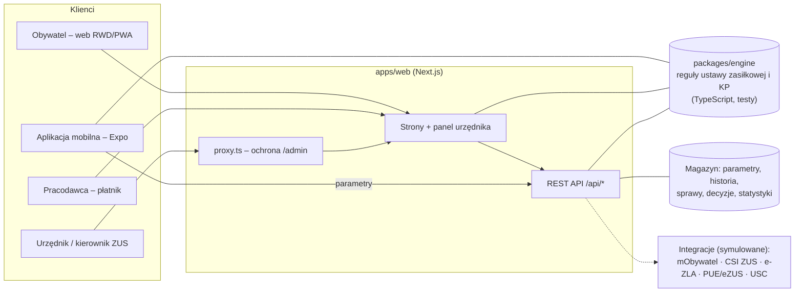
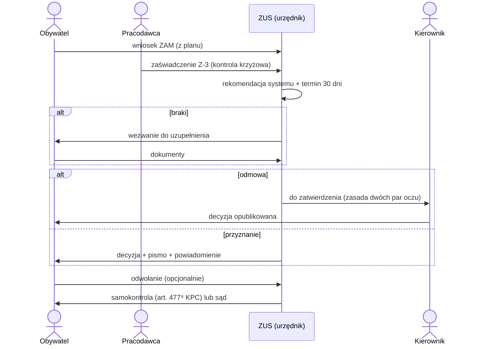

# Zasiłkowy Przewodnik Przyszłego Rodzica

[](https://github.com/Mateuszl28/HackNation2026_ZUS/actions/workflows/ci.yml)

HackNation 2026 · wyzwanie ZUS. Narzędzie (web RWD + aplikacja mobilna), które na podstawie indywidualnej sytuacji ustala uprawnienia do zasiłku chorobowego w ciąży i zasiłku macierzyńskiego, liczy okres i wysokość świadczeń dla obojga rodziców i prowadzi przez wnioski.

## Dla jury – start w 5 minut

Otwórz **`/demo`**: scenariusz krok po kroku (obywatel → urzędnik → pracodawca → decyzja), szybkie wejście w każdą z 8 spraw, logowanie urzędnika jednym kliknięciem i reset danych. Panel urzędnika: `urzednik` / `zus2026`; kierownik (zatwierdza odmowy – zasada dwóch par oczu): `kierownik` / `zus2026k`. Tryb demo (szybkie logowanie i reset) wyłącza się w produkcji zmienną `DEMO_MODE=off`.

## Struktura

```
packages/engine   – wspólny silnik (TypeScript): parametry prawne, kalkulatory, ryzyka, dokumenty, parser PDF→dane, sprawy demo, testy
apps/web          – Next.js (App Router) + Tailwind: aplikacja RWD/PWA + REST API + panel administracyjny
apps/mobile       – Expo / React Native: aplikacja Android/iOS na tym samym silniku, parametry pobierane z API
```

## Architektura



Jeden silnik obliczeń (`packages/engine`) działa w przeglądarce, na serwerze i w aplikacji mobilnej (offline). Parametry prawne są danymi – urzędnik zmienia je w panelu bez wdrażania kodu.

### Obieg sprawy



## Funkcje

| Wymaganie | Gdzie |
|---|---|
| Świadczenia w ciąży: zasiłek chorobowy (kod „B”, okres wyczekiwania, wynagrodzenie chorobowe), świadczenie rehabilitacyjne, zasiłek w wysokości macierzyńskiego przy utracie pracy | `/kalkulator` → „W ciąży” |
| Zintegrowany kalkulator: macierzyński, rodzicielski, ojcowski, uzupełniający (wcześniaki), „Za życiem”, ciąża mnoga, 81,5%, łączenie z pracą, podział między rodziców, adopcja, rodzina zastępcza, martwe urodzenie | `/kalkulator` |
| Planer podziału urlopu rodzicielskiego: do 5 części, naprzemiennie lub jednocześnie, praca do 1/2 etatu – z walidacją puli, 9 tyg. na wyłączność i terminu (KP art. 182¹a–182¹e) | `/kalkulator` → „Podział rodzicielskiego” |
| Indywidualna podstawa wymiaru (13,71%, minimum, limit dla dobrowolnych) | silnik `computeBase` |
| Gdzie złożyć dokumenty (pracodawca > 20 osób vs ZUS), terminy | wynik kalkulatora |
| Zagrożenia i ryzyka (umowa dla pozoru, zawyżona podstawa, ustanie ubezpieczenia, zadłużenie, korekta 81,5%) | kalkulator, pulpit, przewodnik |
| Symulator „Co jeśli…?”: podwyżka, koniec umowy (art. 177 § 3 KP), nowa umowa/firma, rezygnacja z dobrowolnego chorobowego – skutek dla zasiłku i ryzyka | `/co-jesli` |
| Organizacje wsparcia, oficjalne linki (ZUS, MRPiPS, PIP, RSC) | `/wsparcie` |
| Logowanie mObywatel (symulacja) | `/logowanie` |
| Pobranie danych z ZUS: ubezpieczenie, zadłużenie, e-ZLA (symulacja) | `/pulpit`, `GET /api/zus/:id` |
| Kontakt z PUE/eZUS (symulacja) | `/pulpit` |
| Wnioski o urlopy, ZAM, odpis aktu urodzenia (symulacja wysyłki) | `/wnioski` |
| Upload / wybór wniosków PDF, weryfikacja ubezpieczenia | `/sprawy`, `POST /api/parse` |
| Pracodawca (płatnik) wystawia Z-3 / Z-3a z 12 miesięcy wynagrodzeń i wysyła do sprawy w ZUS – urzędnik widzi je z kontrolą krzyżową | `/pracodawca` |
| Obsługa spraw przez urzędnika: kolejka spraw, karta osoby (dane ZUS, wnioski, wyliczenie), rekomendacja systemu, decyzja: przyznanie / odmowa / wezwanie – widoczna u obywatela | `/admin/sprawy` |
| Zasada dwóch par oczu: odmowa wydana przez urzędnika czeka na zatwierdzenie kierownika (zatwierdź / zwróć do poprawy); obywatel widzi tylko decyzje opublikowane | `/admin/sprawy` |
| Odwołanie od decyzji: obywatel składa w aplikacji (termin 1 mies.), ZUS uwzględnia (samokontrola, art. 477⁹ KPC) lub przekazuje do sądu | `/pulpit`, `/admin/sprawy` |
| Panel urzędnika: parametry prawne, organizacje, statystyki, historia zmian | `/admin` – logowanie urzędnika (demo: `urzednik` / `zus2026`; env `ADMIN_LOGIN`, `ADMIN_PASSWORD`, `ADMIN_SECRET`) |

## REST API

- `GET  /api/params` – parametry prawne i lista organizacji
- `PUT  /api/params` – zapis parametrów (sesja urzędnika)
- `GET  /api/admin/cases`, `GET /api/admin/cases/:id`, `POST /api/admin/cases/:id/decision` – sprawy i decyzje (sesja urzędnika)
- `POST /api/applications`, `GET /api/applications?caseId=` – wnioski obywatela do ZUS i jego decyzje
- `POST /api/admin/session` – logowanie urzędnika (ciasteczko httpOnly), `DELETE` – wylogowanie
- `POST /api/calculate` – `CalcInput` → okresy, kwoty, uprawnienia, ryzyka, dokumenty
- `POST /api/sickness` – zasiłek chorobowy w ciąży
- `POST /api/parse` – PDF (multipart `file`) → odczytane pola dokumentu ZUS
- `GET  /api/cases`, `GET /api/zus/:id` – sprawy demonstracyjne i symulacja danych ZUS
- `POST /api/applications/documents` – dokument do sprawy (obywatel / Z-3 od płatnika); `POST /api/applications/appeal` – odwołanie
- `POST /api/admin/cases/:id/approve` – zatwierdzenie / zwrot odmowy (kierownik); `.../appeal` – rozpatrzenie odwołania; `.../notes` – notatki wewnętrzne
- `GET  /api/admin/export?type=cases|stats` – eksport CSV; `GET /api/stats` – anonimowe statystyki (urzędnik)
- `POST /api/assistant` – asystent (reguły, opcjonalnie AI); `POST /api/events` – anonimowe zdarzenia
- `POST /api/demo/official?role=`, `POST /api/demo/reset` – tryb demo (wyłączany `DEMO_MODE=off`)

## Uruchomienie

```bash
npm install
npm run dev          # web: http://localhost:3000
npm test             # testy silnika (jednostkowe)
npm run test:api     # testy end-to-end REST API (na działającym serwerze, BASE_URL)
cd apps/mobile && npm install && npx expo start   # mobile (EXPO_PUBLIC_API_URL=http://<ip>:3000)
```

## Wdrożenie (Docker)

```bash
docker compose up -d --build      # http://localhost:3000
```

Obraz wieloetapowy: instalacja → testy silnika → `next build` (standalone) → lekki obraz `node:24-alpine` uruchamiany jako użytkownik bez uprawnień root, z healthcheckiem. Dane (parametry, historia, sprawy) w wolumenie `zpr-data`. Konfiguracja wyłącznie przez zmienne środowiskowe (`ADMIN_SECRET`, `ADMIN_*`, `MANAGER_*`, `DEMO_MODE`, `AI_*`) – w produkcji ustaw `DEMO_MODE=off` i własny `ADMIN_SECRET`.

## Bezpieczeństwo

- Panel urzędnika chroniony po stronie serwera (`proxy.ts` + każdy endpoint): podpisane ciasteczko httpOnly/SameSite=Strict (HMAC-SHA256), ważność 8 h, role urzędnik/kierownik zapisane w podpisie.
- Ograniczenie prób logowania (5 nieudanych / 15 min → 429) i porównania w stałym czasie.
- Zasada dwóch par oczu dla decyzji odmownych; notatki wewnętrzne nigdy nie trafiają do API obywatela.
- Nagłówki: CSP, HSTS, X-Frame-Options DENY, nosniff, Referrer-Policy, Permissions-Policy.
- Pliki PDF przetwarzane w pamięci (limit 4 MB), nie są zapisywane; statystyki tylko jako anonimowe liczniki kategorii.
- Produkcja: logowanie mObywatel/login.gov.pl i SSO domenowe ZUS w miejsce symulacji, baza danych z audytem.

## Testy

- `npm test` – 26 testów jednostkowych silnika (wymiary urlopów, stawki, podstawa wymiaru, uzupełniający, 81,5%, ciąża, planer rodzicielskiego, rekomendacje decyzji, parser).
- `npm run test:api` – 12 testów end-to-end REST API na działającym serwerze (kontrakty, zabezpieczenia, pełny obieg sprawy, odwołanie, zasada dwóch par oczu).
- GitHub Actions (`.github/workflows/ci.yml`) przy każdym pushu: testy silnika → typecheck → build produkcyjny → start serwera → testy e2e API.

## Źródła prawne i weryfikacja

Parametry zweryfikowano z materiałami ZUS dla uczestników HackNation 2026: załącznik „maksymalny czas trwania zasiłków, wysokość, podstawa wymiaru”, wyciąg z ustawy zasiłkowej (m.in. art. 29a, 31 ust. 1–4a, 36–38, 49), wyciąg z Kodeksu pracy (art. 177, 180–183) oraz Poradnik dla rodziców ZUS 2026. Wszystkie wartości są edytowalne w panelu `/admin` (z historią zmian).

## Sztuczna inteligencja

Obliczenia i ustalanie uprawnień są deterministyczne (reguły z ustawy zasiłkowej i Kodeksu pracy) – nie korzystają z AI. Odczyt dokumentów PDF działa heurystycznie (ekstrakcja tekstu + reguły). Asystent działa na regułach; opcjonalnie (po ustawieniu `AI_GATEWAY_API_KEY` i `AI_MODEL`) model językowy przeredagowuje jego odpowiedź prostszym językiem – dostaje wyłącznie wyniki kalkulatora i nie zmienia liczb. AI wykorzystano także do tworzenia niektórych elementów kodu.

## Dane

Sprawy demonstracyjne w repozytorium są fikcyjne. Dokumenty udostępnione przez ZUS na potrzeby HackNation nie są umieszczane w repozytorium – można je wgrać lokalnie przez `/sprawy`.

> Narzędzie ma charakter informacyjny. Wiążące decyzje wydaje ZUS lub płatnik składek.
